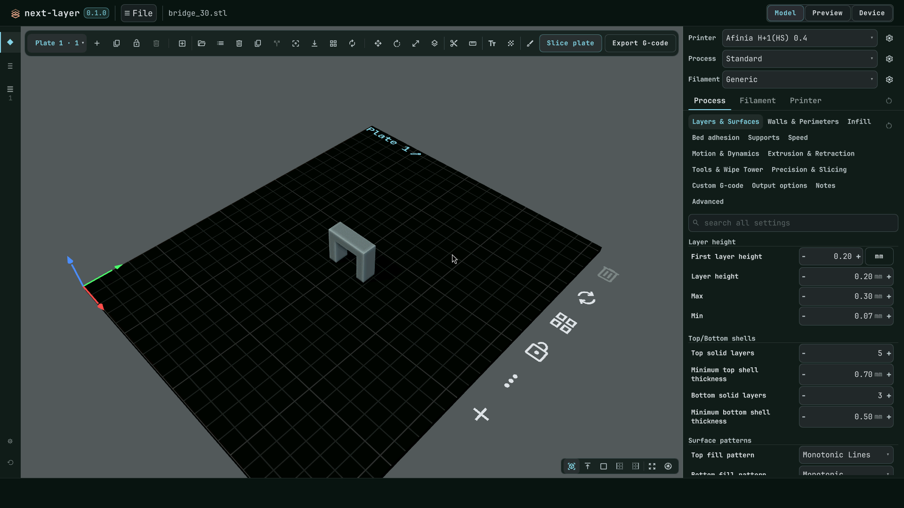
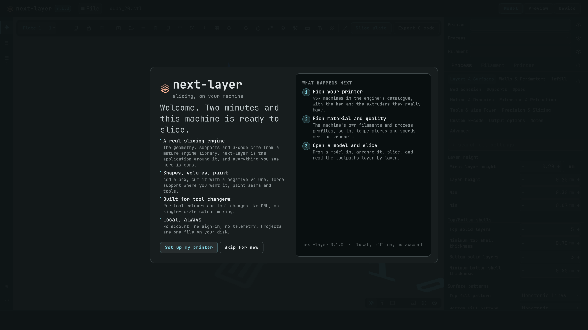

# next-layer

A 3D printer slicer. An application of our own on top of an open-source slicing
engine, used as a library: the engine does the geometry and the G-code, this
repository is the program you look at.

Source: <https://github.com/CWebb89/NextLayer>



Alpha, `0.1.0`. It slices and prints, and it does not yet do everything the mature
slicers do — `docs/features.md` is the ledger, with every tab, tool and setting
marked done, staged or blocked on the engine. What has been proven on hardware is
recorded in `docs/real-prints.md`, and `docs/release-audit.md` is the honest
version of every claim on this page, with the code behind each one.

## What it is

- **A real engine underneath.** Supports, seams, variable layer height, adaptive
  infill: the parts of slicing that are geometry come from the engine this project
  links, not from code rewritten here.
- **Built for tool changers.** Per-tool filaments, per-tool colours, tool changes;
  no MMU and no single-nozzle colour mixing. Implemented, and not yet verified on
  hardware: the only print recorded so far is on a single-extruder machine.
- **A Qt Quick 3D interface.** Its own viewport, its own G-code preview, its own
  settings panel. Not a skin over a wxWidgets app.
- **Local.** No account, no telemetry, no cloud. Projects are one file on your
  disk. It talks to a network at all only when you send a print to a host you
  configured, or press *Check for updates* — both are listed in `docs/network.md`.

## What it is not

- Not a fork of another slicer's GUI. The interface, the scene and the toolpaths'
  presentation are written here.
- Not a reimplementation of a slicing engine. That would be a decade of work and
  it has already been done better than we would.
- Not stable. Settings names, file formats and the CLI may move between tags.

If any of the above reads as more detail than you want, `docs/what-is-next-layer.md`
is the same thing in plain words, with the current bugs listed and no marketing.

## Requirements

Linux, a C++ compiler, CMake, Ninja, Qt 6.12 (Quick, Quick3D, Svg, WebEngine,
Network, OpenGL), fontconfig, and `fish` shell for the scripts in `tools/`. Qt
6.12.0 is the only version this release was built and tested against; no minimum
is declared in the CMake files, so a different Qt is untried rather than
supported. On Arch:

```sh
sudo pacman -S base-devel cmake ninja git fish fontconfig \
    qt6-base qt6-declarative qt6-quick3d qt6-svg qt6-webengine
```

A GPU with a working OpenGL driver: the viewport is real 3D and there is no
software fallback. One machine's driver is what the viewport has actually been
run on.

## Build

```sh
tools/bootstrap            # fetch the engine at its pinned commit, apply patches/
mkdir -p upstream/build
cd upstream/build
cmake .. -G Ninja -DCMAKE_BUILD_TYPE=Release -DSLIC3R_GUI=ON
cmake --build . --target next-layer-qt -j4
```

`tools/bootstrap` needs the network once. The configure step fetches the engine's
own dependency tree — tens of gigabytes of source and **hours** on a first build,
most of it compiling Boost, CGAL, OpenVDB and OpenCASCADE. After that, a rebuild
is the last line only.

Two things worth knowing:

- The engine tree under `upstream/` is a dependency, never a place to keep work.
  It is gitignored, and our entire footprint in it is the patches in `patches/`
  (the build hook and one preview role the engine does not carry).
- Compiling this saturates memory before it saturates cores. `-j4` is deliberate;
  on a 16 GB machine with no swap beyond zram, a higher job count has frozen the
  desktop.

The printer catalog is generated, not committed:

```sh
tools/printer-catalog/generate.py --from <profile checkout>/resources/profiles \
    --out upstream/resources/presets/vendor-catalog
```

Run it before `tools/check` or the first launch if you want more than the machines
the engine ships.

## Install

`v0.1.0` publishes three things on its release page: a self-contained AppImage, a
tarball the AUR package unpacks, and the update manifest. Neither install needs a
compiler:

```sh
# self-contained, nothing installed
chmod +x NextLayer-0.1.0-x86_64.AppImage && ./NextLayer-0.1.0-x86_64.AppImage

# Arch: builds nothing, unpacks the release tarball
paru -S next-layer-bin
```

Both were built and run from a clean prefix before publishing. If something is
missing on your machine, it will say so on stderr — there is no crash reporter
and nothing is sent anywhere, so a terminal paste is the only report we get.

## Run

From a build tree:

```sh
upstream/build/src/next-layer-qt/next-layer-qt model.stl
```

The binary looks for its QML and resources beside itself and in
`../share/next-layer/` before falling back to a compile-time path, so it runs from
any directory and from a packaged install. `--help` lists the headless knobs
(`--smoke`, `--selftest-slice`, `--dump-config`, `--dump-tabs`); they exist so this
project can be verified without a window, and they are documented in
`src/qt/README.md`.

## First launch

**No printer ships with it.** There is no default machine, no default bed and no
profile that pretends to be yours:



The first launch asks you what you print on, and until you answer there is no bed
to place anything on:

- **Pick your printer** from the catalog of vendor profiles, or
- **Create your own**: a name and the three bed dimensions is enough, and that
  printer preset is yours, inherited from nobody, or
- **Import my presets**: reads another slicer's configuration directory (the
  profile folders those apps write under your config home are detected) and
  writes the machines, processes and filaments this engine can express into your
  own bundle, under their own names. Settings with no equivalent are dropped and
  counted, never guessed at. The engine reads its preset bundle once per start,
  so the app restarts itself to make them selectable.

Setup stores the machine, the material and the process; the next launch opens
straight onto the plate you left.

## Verifying a change

```sh
tools/check          # every gate, including the slicing oracle
tools/check --fast   # the same minus the oracle
```

Every gate reads its verdict out of a tool's output — a coverage percentage, a
setting count, a layer count, a byte-identical match — and none infers a pass from
an exit code. The oracle slices a corpus of models and compares fingerprints
against recorded baselines, which is what catches a change in the engine's
behaviour rather than in its return value.

`docs/testing.md` is the walkthrough for testing the application by hand: the
headless knobs, driving the window with `tools/cockpit`, the preset importer end
to end, and the checks worth repeating before a release.

Slicing parity on its own:

```sh
python3 oracle/oracle.py verify --runner qt --bin upstream/build/src/next-layer-qt/next-layer-qt
```

## Licence

AGPL-3.0-or-later. Copyright (C) 2026 Curtis Webb.

The engine this program links is AGPL-3.0 and so is the profile data imported into
it, which makes the combined program AGPL-3.0 — `LICENSE` is the full text, and
`THIRD-PARTY.md` names every component, its licence and where the authoritative
copy lives.

## Contributing

`CONTRIBUTING.md` has the rules that are not negotiable, most of which exist
because this project depends on an upstream it does not own. Security problems go
through `SECURITY.md`, not the issue tracker.
